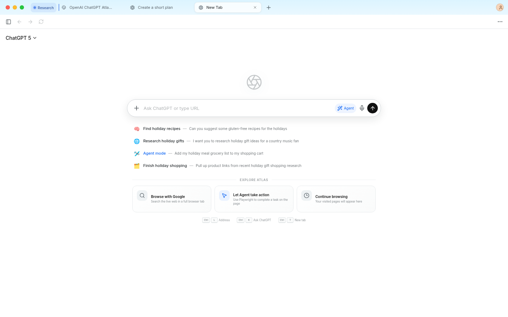
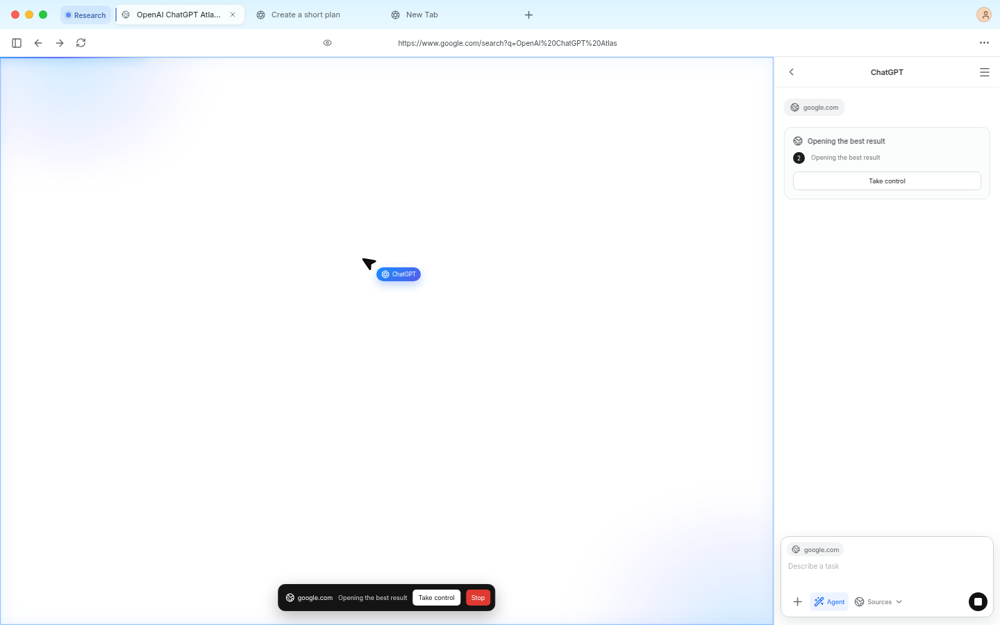

# ChatGPT Atlas Clone

Atlas Desk is an Electron reconstruction of the public ChatGPT Atlas experience: persistent browser tabs, Google search and URL navigation, draggable Chrome-style tab groups, page-aware side chat, browser memories, selection assistance, and Playwright-powered agent mode. The interface includes detached rounded tabs and smooth motion for tabs, pages, messages, the sidebar, menus, modals, controls, and agent activity. During agent actions, a blue activity field and a visible ChatGPT cursor move to the actual Playwright target.

## Tested interface





Additional captured states are in [`artifacts/screenshots`](./artifacts/screenshots).

## Run it

```bash
npm install
npm run dev
```

For a production launch:

```bash
npm run start
```

The included launcher uses the AppImage when present, then the unpacked build, and finally the source development fallback:

```bash
./start-atlas.sh
```

Build an unpacked Linux desktop artifact with:

```bash
npm run package:dir
npm run test:electron
```

The unpacked executable is created at `dist/linux-unpacked/atlas-desk`.

Build a portable Linux AppImage with:

```bash
npm run package:linux
```

## Connect an LLM

Atlas expects an OpenAI-compatible Responses API. The key stays in Electron's main process and is never exposed to the renderer.

```bash
ATLAS_LLM_API_KEY=your_key npm run dev
```

Optional variables:

```bash
ATLAS_LLM_MODEL=gpt-5-mini
ATLAS_LLM_BASE_URL=https://api.openai.com/v1
```

The older `ATLAS_OPENAI_API_KEY` and `ATLAS_OPENAI_MODEL` names are also accepted.

If the key is missing, the provider is offline, or the API reports exhausted credits, Atlas switches automatically to a clearly labeled scripted fallback. Chat can summarize visible page text and produce basic plans, comparisons, and drafts. Agent mode uses Playwright to perform a short deterministic sequence on visible controls, then stops and returns control. Open-ended planning resumes when an LLM is available.

## Playwright agent mode

Agent mode uses `playwright-core` to connect to Electron's embedded Chromium over a loopback CDP port. It reads the visible tab, indexes interactive controls and their on-screen bounds, asks the configured LLM for one bounded action at a time, and executes that action in the same visible page. No separate Playwright browser download is required.

Run the focused checks with:

```bash
npm run build
npm run test:ui
npm run test:agent
npm run test:fallback
npm run test:browser
```

The final REA bundle-analysis record and its evidence boundary are documented in [`REA_EVIDENCE.md`](./REA_EVIDENCE.md).
